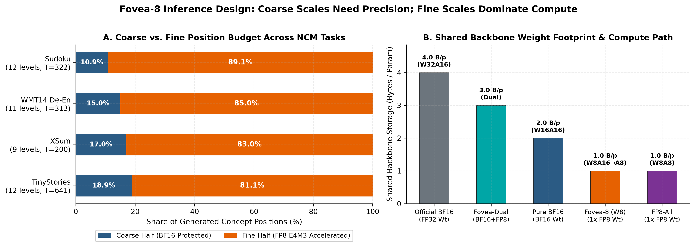
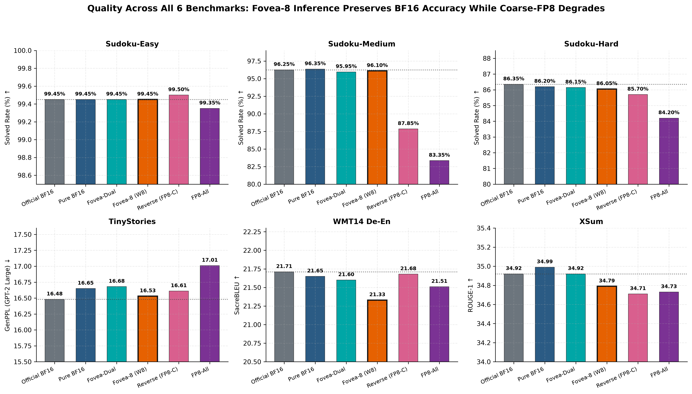
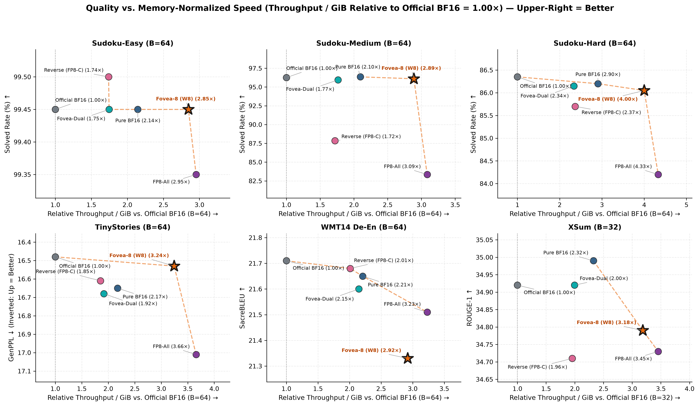
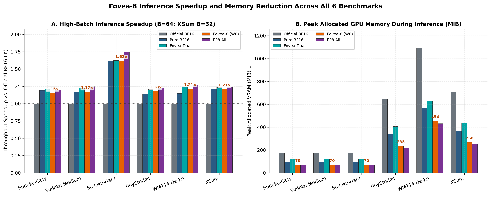
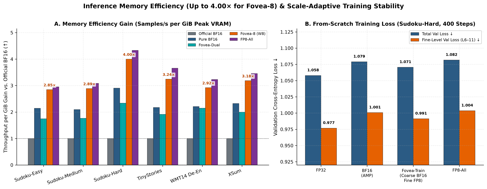
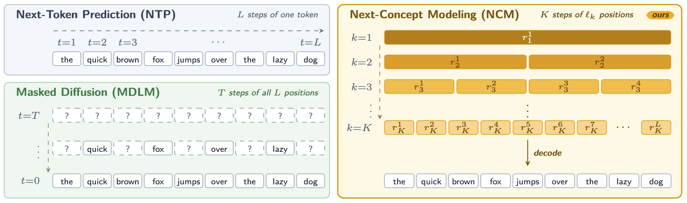
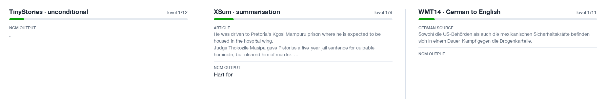
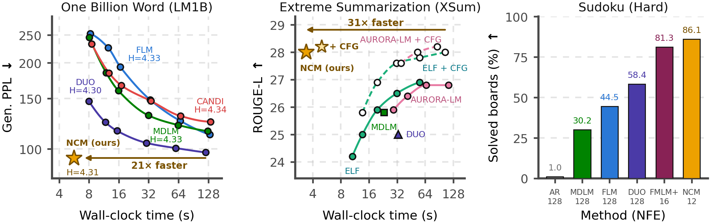

<h1 align="center"> Fovea-8 Inference for Next-Concept Modeling</h1>

<p align="center"><strong>Foveated Scale-Adaptive Mixed Precision (BF16 Coarse + FP8 Fine) for Fast, Memory-Efficient Coarse-to-Fine Text Generation</strong></p>

<p align="center">
  <a href="outputs/mixed_precision/report/FOVEA8_REPORT.md"></a>
  <a href="https://github.com/HazyResearch/ncm"></a>
  <a href="https://arxiv.org/abs/2610.14162"></a>
  <a href="https://huggingface.co/collections/hazyresearch/ncm"></a>
  <a href="https://hazyresearch.stanford.edu/blog/2026-10-12-ncm"></a>
  <a href="https://scalingintelligence.stanford.edu/blogs/ncm/"></a>
  <a href="https://x.com/KumbongHermann"></a>
  <a href="LICENSE"></a>
</p>

This repository is a forked extension of [HazyResearch/ncm](https://github.com/HazyResearch/ncm) (based on commit `8a7f124`), adding **Fovea-8 Inference** (`coarse_bf16_fine_fp8_w8`), a foveated scale-adaptive mixed-precision scheme for **Next-Concept Modeling (NCM)**: high-acuity **BF16** compute in the coarse "fovea" (global structural scaffold) and fast **8-bit FP8 (`float8_e4m3fn`)** Tensor Core execution in the fine "periphery" (local high-frequency refinement), stored with a **single-copy FP8 backbone (`1 byte/param`)**.

> **Full Technical Report:** [outputs/mixed_precision/report/FOVEA8_REPORT.md](outputs/mixed_precision/report/FOVEA8_REPORT.md)

---

## Fovea-8 Inference: Overview & Key Results

Next-Concept Modeling (NCM) generates text from **coarse-to-fine** across a hierarchy of $K$ discrete concept scales in parallel. Across all six benchmarks (`sudoku-easy`, `sudoku-medium`, `sudoku-hard`, `tinystories`, `wmt14`, and `xsum`), the coarse half of the hierarchy constitutes only **10.9%–18.9%** of generated concept positions, while the fine half accounts for **81.1%–89.1%**.

Evaluated on an **NVIDIA GeForce RTX 4080 Laptop GPU** (Ada Lovelace `sm_89`, 12 GB VRAM, native Windows with CUDA Graphs + prefix KV caching, `--no-compile`):

- **Quality parity across all 6 tasks:** Matches `official_bf16` / `pure_bf16` within **0.00–0.30%** on Sudoku (`99.45%` / `96.10%` / `86.05%`), scores **16.53** genPPL on TinyStories (vs. `16.48` official BF16), **21.33** SacreBLEU on WMT14, and **34.79** ROUGE-1 on XSum — whereas quantizing the coarse levels (`coarse_fp8_fine_bf16` or `fp8_all`) drops `sudoku-medium` accuracy by **-8.40% to -12.90%**.
- **1.15×–1.62× faster high-batch inference** over `official_bf16` (and up to **1.32×** with dual-weight `Fovea-Dual` on `tinystories` at `B=16`).
- **2.41×–2.87× smaller peak allocated VRAM** (`53.65 MiB` weights / `70.47 MiB` peak on Sudoku; `208.20 / 235.05 MiB` on TinyStories; `429.37 / 453.93 MiB` on WMT14; `242.59 / 267.79 MiB` on XSum).
- **2.85×–4.00× higher memory efficiency** (`samples/s per GiB` of peak allocated VRAM) over `official_bf16` across all 6 tasks.
- **Stable scale-adaptive training:** 400-step from-scratch `sudoku-hard` training with BF16 coarse + FP8 fine achieves **1.0706** validation loss (outperforming BF16 AMP `1.0790` and `fp8_all` `1.0817` with 0 NaNs).

<p align="center">
  
</p>

### How Fovea-8 Inference Works

1. **Coarse-to-Fine Error Cascade & Reverse Control:** An error at coarse level $j \in [0, K/2)$ alters $\hat{z}_j$ and cascades into every subsequent scale. Quantizing *only* the 11%–19% coarse tokens (`coarse_fp8_fine_bf16`) collapses `sudoku-medium` from **96.35% → 87.85%** (`-8.50%`), and `fp8_all` collapses to **83.35%** (`-12.90%`). Protecting coarse levels and quantizing the 81%–89% fine tokens (`coarse_bf16_fine_fp8_w8`) holds **96.10%**.
2. **Static Activation Calibration & CUDA Graphs:** Running 4 warmup calibration batches records per-module, per-level `abs().amax()` into GPU scalar buffers (`static_scale`, `static_inv_scale`). Because `ctx.level_idx` is a static Python integer per unrolled level in `NextConceptTransformer.generate()`, `CUDAGraphRunner` captures constant scale pointers with zero host synchronization and eliminates runtime `amax()` reductions.
3. **Single-Copy FP8 Shared Backbone (`W8A16` Coarse / `W8A8` Fine):** Implemented in [`experiments/mixed_precision/fp8_layers.py`](experiments/mixed_precision/fp8_layers.py), shared backbone `nn.Linear` layers store a single `float8_e4m3fn` weight (`1 byte/param` + scalar `w_scale`). Prefix and coarse levels (`level_idx < K // 2`) dequantize to BF16 (`W8A16`), fine levels (`level_idx >= K // 2`) execute on native FP8 Tensor Cores via `torch._scaled_mm` (`W8A8`), and per-level `lm_heads[i]` and `vq.embeddings[i]` remain BF16 for coarse levels and FP8 for fine levels.

### Quality Results Across All 6 Benchmarks

Full test splits scored via [`scripts/eval_merge.py`](scripts/eval_merge.py) (`sudoku-*`: 2,000 boards; `tinystories`: 1,280 samples across 5 seeds with `gpt2-large`; `wmt14`: 3,003 sentences; `xsum`: 11,334 documents). Raw metrics: [`outputs/mixed_precision/eval_full/summary_full.json`](outputs/mixed_precision/eval_full/summary_full.json).

| Task | Primary Metric | `official_bf16` | `pure_bf16` | `Fovea-Dual` (`coarse_bf16_fine_fp8`) | `Fovea-8` (`coarse_bf16_fine_fp8_w8`) | `Reverse` (`coarse_fp8_fine_bf16`) | `fp8_all` |
|---|---|---:|---:|---:|---:|---:|---:|
| **`sudoku-easy`** | Solved % (↑) | 99.45% (`1989/2000`) | 99.45% (`1989/2000`) | 99.45% (`1989/2000`) | **99.45%** (`1989/2000`) | 99.50% (`1990/2000`) | 99.35% (`1987/2000`) |
| **`sudoku-medium`** | Solved % (↑) | 96.25% (`1925/2000`) | 96.35% (`1927/2000`) | 95.95% (`1919/2000`) | **96.10%** (`1922/2000`) | **87.85%** (`1757/2000`) | **83.35%** (`1667/2000`) |
| **`sudoku-hard`** | Solved % (↑) | 86.35% (`1727/2000`) | 86.20% (`1724/2000`) | 86.15% (`1723/2000`) | **86.05%** (`1721/2000`) | 85.70% (`1714/2000`) | **84.20%** (`1684/2000`) |
| **`tinystories`** | GenPPL (↓) / Ent | 16.48 / 3.9745 | 16.65 / 3.9728 | 16.68 / 3.9721 | **16.53** / 3.9721 | 16.61 / 3.9737 | 17.01 / 3.9717 |
| **`wmt14`** | BLEU / chrF (↑) | 21.71 / 49.66 | 21.65 / 49.57 | 21.60 / 49.49 | **21.33** / 49.37 | 21.68 / 49.58 | 21.51 / 49.41 |
| **`xsum`** | R-1 / R-L (↑) | 34.92 / 27.94 | 34.99 / 27.96 | 34.92 / 27.90 | **34.79 / 27.83** | 34.71 / 27.78 | 34.73 / 27.71 |
| **`xsum` (genPPL)** | GPT-2 PPL (↓) | 82.71 | 82.30 | 83.23 | **82.86** | 83.65 | 83.44 |

<p align="center">
  
</p>

### Inference Speed, VRAM & Memory Efficiency

High-batch benchmarks (1,024 samples, 10 warmups, 3 timed repeats with CUDA Graphs). Full 72-run results (including `B=16` and `Reverse`): [`outputs/mixed_precision/benchmark/summary_full.json`](outputs/mixed_precision/benchmark/summary_full.json).

| Task (Batch) | Metric | `official_bf16` | `pure_bf16` | `Fovea-Dual` | `Fovea-8 (W8)` | `fp8_all` |
|---|---|---:|---:|---:|---:|---:|
| **`sudoku-easy`** (B=64) | Time / Samp/s | 2.256s / 453.80 | 1.892s / 541.31 | 1.859s / 550.84 | **1.960s / 522.54** (`1.15×`) | 1.890s / 541.70 |
| | Weight / Peak (MiB) | 155.68 / 174.24 | 77.84 / 96.91 | 101.90 / 121.10 | **53.65 / 70.47** | 53.58 / 70.41 |
| | Samp/s per GiB | 2,666.98 | 5,719.70 | 4,657.88 | **7,592.78** (**2.85×**) | 7,878.45 |
| **`sudoku-medium`** (B=64) | Time / Samp/s | 2.257s / 453.69 | 1.937s / 528.77 | 1.839s / 556.82 | **1.932s / 530.06** (`1.17×`) | 1.810s / 565.59 |
| | Weight / Peak (MiB) | 155.68 / 174.24 | 77.84 / 96.91 | 101.90 / 121.10 | **53.65 / 70.47** | 53.58 / 70.41 |
| | Samp/s per GiB | 2,666.30 | 5,587.24 | 4,708.47 | **7,702.03** (**2.89×**) | 8,225.89 |
| **`sudoku-hard`** (B=64) | Time / Samp/s | 3.130s / 327.18 | 1.937s / 528.61 | 1.927s / 531.34 | **1.934s / 529.36** (`1.62×`) | 1.788s / 572.77 |
| | Weight / Peak (MiB) | 155.68 / 174.24 | 77.84 / 96.91 | 101.90 / 121.10 | **53.65 / 70.47** | 53.58 / 70.41 |
| | Samp/s per GiB | 1,922.81 | 5,585.53 | 4,492.99 | **7,691.92** (**4.00×**) | 8,330.36 |
| **`tinystories`** (B=64) | Time / Samp/s | 6.332s / 161.71 | 5.542s / 184.76 | 5.258s / 194.74 | **5.370s / 190.70** (`1.18×`) | 5.168s / 198.15 |
| | Weight / Peak (MiB) | 617.93 / 646.46 | 309.16 / 339.70 | 370.76 / 406.11 | **208.20 / 235.05** | 190.29 / 216.53 |
| | Samp/s per GiB | 256.15 | 556.94 | 491.02 | **830.80** (**3.24×**) | 937.06 |
| **`wmt14`** (B=64) | Time / Samp/s | 5.051s / 202.72 | 4.397s / 232.90 | 4.083s / 250.80 | **4.170s / 245.59** (`1.21×`) | 3.973s / 257.77 |
| | Weight / Peak (MiB) | 1074.93 / 1094.36 | 537.64 / 569.36 | 591.93 / 630.18 | **429.37 / 453.93** | 406.87 / 430.87 |
| | Samp/s per GiB | 189.69 | 418.87 | 407.53 | **554.02** (**2.92×**) | 612.60 |
| **`xsum`** (B=32) | Time / Samp/s | 11.540s / 88.74 | 9.559s / 107.13 | 9.359s / 109.41 | **9.560s / 107.11** (`1.21×`) | 9.277s / 110.37 |
| | Weight / Peak (MiB) | 680.25 / 706.54 | 340.27 / 366.91 | 405.15 / 436.29 | **242.59 / 267.79** | 229.46 / 254.42 |
| | Samp/s per GiB | 128.61 | 298.97 | 256.79 | **409.59** (**3.18×**) | 444.23 |

<p align="center">
  
</p>

<p align="center">
  
</p>

### Training Feasibility & Pareto Summary

Using block-diagonal split-precision training (`_FP8LinearFn` with `float8_e4m3fn` forward and `float8_e5m2` backward gradients in [`experiments/mixed_precision/train_mixed_precision.py`](experiments/mixed_precision/train_mixed_precision.py), logged in [`outputs/mixed_precision/train/summary.json`](outputs/mixed_precision/train/summary.json)):

- **From-scratch convergence (`sudoku-hard`, 400 steps, B=32):** All regimes trained with **0 NaN steps**. `coarse_bf16_fine_fp8` reached **1.0706** validation loss (fine-level loss **0.9913**), outperforming both BF16 AMP (**1.0790** / fine **1.0007**) and `fp8_all` (**1.0817** / fine **1.0037**), and closely tracking FP32 (**1.0579**).
- **PTQ vs. QAT:** Because static-calibrated `Fovea-8 Inference` is already near-lossless (`99.45%` / `96.10%` / `86.05%` on Sudoku), short 100-step unwarmed QAT on 1,800 boards was unnecessary (`87.5% → 84.0%` on the 200-board validation slice for `coarse_bf16_fine_fp8`; `85.0% → 85.0%` for `fp8_all`).
- **Eager Windows vs. fused Linux kernels:** Without `torch.compile` / Triton kernel fusion on Windows, eager `_FP8LinearFn` launches ~10 separate quantize/cast/transpose kernels per linear layer, making eager FP8 training slower than cuBLAS BF16 AMP (`315.30 ms/step` vs. `191.47 ms/step` on `sudoku-hard`; `446.48 ms/step` vs. `420.40 ms/step` on `xsum B=16`), whereas Linux fused kernels (`torch.compile` / `torchao` / Transformer Engine) eliminate those intermediate casts.

<p align="center">
  
</p>

| Criterion | `official_bf16` | `pure_bf16` | `Fovea-Dual` | `fp8_all` | `Fovea-8` (`coarse_bf16_fine_fp8_w8`) |
|---|---|---|---|---|---|
| **Quality** | Baseline | Preserved | Preserved | Collapses on reasoning (`-12.9%`) | **Preserved across all 6 tasks** |
| **Inference Speed** | 1.00× | 1.15×–1.62× | **1.20×–1.62×** | 1.20×–1.75× | **1.15×–1.62×** |
| **Weight VRAM** | 4.0 B/p | 2.0 B/p | 3.0 B/p | **1.0 B/p** | **1.0 B/p (2.4×–2.9× peak savings)** |
| **Throughput / GiB** | 1.00× | 2.10×–2.91× | 1.75×–2.34× | 2.95×–4.33× | **2.85×–4.00× (Best lossless frontier)** |

### Reproducing Fovea-8 Experiments

After downloading the checkpoints (`artifacts/`) and datasets (`data/`) as described in [Installation](#installation) and [Evaluation](#evaluation):

```bash
# 1. Unit tests for FP8 layers and scale routing
python experiments/mixed_precision/test_fp8_layers.py

# 2. Full 6-task x 6-mode quality evaluation (static FP8 calibration)
python experiments/mixed_precision/eval_mixed_precision.py --act-scaling static

# 3. Full 72-run inference speed & VRAM benchmark
python experiments/mixed_precision/benchmark_mixed_precision.py --auto-batch-sizes --samples 1024 --warmup 10 --repeats 3

# 4. From-scratch training convergence, QAT recovery, and training scaling study
python experiments/mixed_precision/train_mixed_precision.py

# 5. Regenerate all 5 report figures
python experiments/mixed_precision/generate_figures.py
```

---

## Next-Concept Modeling (Base Framework)

Next-Concept Modeling (NCM) is a two-stage framework for parallel text generation. A multiscale residual VQ tokenizer represents a sequence as a hierarchy of discrete codes, and a transformer predicts that hierarchy from coarse to fine. Positions within a level are generated in parallel, so generation requires one forward evaluation per level.

<p align="center">
  
</p>

## Highlights

### Coarse-to-fine generation

NCM generates coarse to fine: each level predicts a longer sequence in parallel, and decoding every level shows a sample being refined from a rough sketch to the full output in a few steps.

<p align="center"></p>

### Quality at a fraction of the cost

NCM beats or matches strong diffusion baselines on different tasks & datasets while generating 9-31× faster.

<p align="center">
  
</p>

## Released models

Weights and tokenized datasets are hosted in the [NCM Hugging Face collection](https://huggingface.co/collections/hazyresearch/ncm). Each released model consists of a frozen tokenizer and a next-concept generator.

<table>
  <thead>
    <tr><th>Task</th><th>Model</th><th>Tokenizer</th><th>Generator</th><th>Config</th><th>Data</th></tr>
  </thead>
  <tbody>
    <tr><td rowspan="1"><b>XSum</b></td><td>&ndash;</td><td><a href="https://huggingface.co/hazyresearch/ncm-checkpoints/blob/main/xsum/tokenizer.pt">tokenizer.pt</a></td><td><a href="https://huggingface.co/hazyresearch/ncm-checkpoints/blob/main/xsum/generator.pt">generator.pt</a></td><td><a href="https://huggingface.co/hazyresearch/ncm-checkpoints/blob/main/xsum/config.yaml">config.yaml</a></td><td rowspan="1"><a href="https://huggingface.co/datasets/hazyresearch/ncm-datasets/tree/main/xsum">test set</a></td></tr>
    <tr><td rowspan="1"><b>WMT14 De&ndash;En</b></td><td>&ndash;</td><td><a href="https://huggingface.co/hazyresearch/ncm-checkpoints/blob/main/wmt14/tokenizer.pt">tokenizer.pt</a></td><td><a href="https://huggingface.co/hazyresearch/ncm-checkpoints/blob/main/wmt14/generator.pt">generator.pt</a></td><td><a href="https://huggingface.co/hazyresearch/ncm-checkpoints/blob/main/wmt14/config.yaml">config.yaml</a></td><td rowspan="1"><a href="https://huggingface.co/datasets/hazyresearch/ncm-datasets/tree/main/wmt14">test set</a></td></tr>
    <tr><td rowspan="3"><b>Sudoku</b></td><td>easy</td><td><a href="https://huggingface.co/hazyresearch/ncm-checkpoints/blob/main/sudoku/easy/tokenizer.pt">tokenizer.pt</a></td><td><a href="https://huggingface.co/hazyresearch/ncm-checkpoints/blob/main/sudoku/easy/generator.pt">generator.pt</a></td><td><a href="https://huggingface.co/hazyresearch/ncm-checkpoints/blob/main/sudoku/easy/config.yaml">config.yaml</a></td><td rowspan="3"><a href="https://huggingface.co/datasets/hazyresearch/ncm-datasets/tree/main/sudoku">test boards</a></td></tr>
    <tr><td>medium</td><td><a href="https://huggingface.co/hazyresearch/ncm-checkpoints/blob/main/sudoku/medium/tokenizer.pt">tokenizer.pt</a></td><td><a href="https://huggingface.co/hazyresearch/ncm-checkpoints/blob/main/sudoku/medium/generator.pt">generator.pt</a></td><td><a href="https://huggingface.co/hazyresearch/ncm-checkpoints/blob/main/sudoku/medium/config.yaml">config.yaml</a></td></tr>
    <tr><td>hard</td><td><a href="https://huggingface.co/hazyresearch/ncm-checkpoints/blob/main/sudoku/hard/tokenizer.pt">tokenizer.pt</a></td><td><a href="https://huggingface.co/hazyresearch/ncm-checkpoints/blob/main/sudoku/hard/generator.pt">generator.pt</a></td><td><a href="https://huggingface.co/hazyresearch/ncm-checkpoints/blob/main/sudoku/hard/config.yaml">config.yaml</a></td></tr>
    <tr><td rowspan="3"><b>LM1B</b></td><td>small</td><td rowspan="3"><a href="https://huggingface.co/hazyresearch/ncm-checkpoints/blob/main/lm1b/tokenizer.pt">tokenizer.pt</a></td><td><a href="https://huggingface.co/hazyresearch/ncm-checkpoints/blob/main/lm1b/small/generator.pt">generator.pt</a></td><td><a href="https://huggingface.co/hazyresearch/ncm-checkpoints/blob/main/lm1b/small/config.yaml">config.yaml</a></td><td rowspan="3"><a href="https://huggingface.co/datasets/hazyresearch/ncm-datasets/tree/main/lm1b">tokenized text</a></td></tr>
    <tr><td>medium</td><td><a href="https://huggingface.co/hazyresearch/ncm-checkpoints/blob/main/lm1b/medium/generator.pt">generator.pt</a></td><td><a href="https://huggingface.co/hazyresearch/ncm-checkpoints/blob/main/lm1b/medium/config.yaml">config.yaml</a></td></tr>
    <tr><td>large</td><td><a href="https://huggingface.co/hazyresearch/ncm-checkpoints/blob/main/lm1b/large/generator.pt">generator.pt</a></td><td><a href="https://huggingface.co/hazyresearch/ncm-checkpoints/blob/main/lm1b/large/config.yaml">config.yaml</a></td></tr>
    <tr><td rowspan="1"><b>TinyStories</b></td><td>&ndash;</td><td><a href="https://huggingface.co/hazyresearch/ncm-checkpoints/blob/main/tinystories/tokenizer.pt">tokenizer.pt</a></td><td><a href="https://huggingface.co/hazyresearch/ncm-checkpoints/blob/main/tinystories/generator.pt">generator.pt</a></td><td><a href="https://huggingface.co/hazyresearch/ncm-checkpoints/blob/main/tinystories/config.yaml">config.yaml</a></td><td rowspan="1"><a href="https://huggingface.co/datasets/hazyresearch/ncm-datasets/tree/main/tinystories">tokenized text</a></td></tr>
    <tr><td rowspan="1"><b>OpenWebText</b></td><td>&ndash;</td><td><a href="https://huggingface.co/hazyresearch/ncm-checkpoints/blob/main/owt/tokenizer.pt">tokenizer.pt</a></td><td><a href="https://huggingface.co/hazyresearch/ncm-checkpoints/blob/main/owt/generator.pt">generator.pt</a></td><td><a href="https://huggingface.co/hazyresearch/ncm-checkpoints/blob/main/owt/config.yaml">config.yaml</a></td><td rowspan="1"><a href="https://huggingface.co/datasets/hazyresearch/ncm-datasets/tree/main/owt">tokenized text</a></td></tr>
  </tbody>
</table>

## Installation

```bash
git clone https://github.com/abhilad1009/ncm-fovea-8.git
cd ncm-fovea-8
pip install -r requirements.txt
```

Python 3.10 or newer and a CUDA-capable PyTorch installation are recommended (FP8 Tensor Core kernels require Ada Lovelace `sm_89` or Hopper `sm_90+`).

## Evaluation

Download the checkpoints and evaluation inputs:

```bash
hf download hazyresearch/ncm-checkpoints --local-dir artifacts
hf download hazyresearch/ncm-datasets --repo-type dataset --local-dir data
```

Then run:

```bash
python evaluate.py --config config/eval/<task>.yaml --checkpoint-dir artifacts/<task> --data-dir data/<task>
# <task> is one of xsum, wmt14, sudoku-easy, sudoku-medium or sudoku-hard

python evaluate.py --config config/eval/<dataset>.yaml --checkpoint-dir artifacts/<dataset>
# <dataset> is tinystories, owt or lm1b-<size> with <size> one of small, medium or large
```

This runs one generation shard per visible GPU, merges them, and prints ROUGE-1/2/L and generative perplexity for XSum; cased and lowercased sacreBLEU, chrF and length ratio for WMT14; solved, cell and valid-grid rates for Sudoku; and generative perplexity under GPT-2 large with unigram entropy, over 5 seeds of 256 unconditional samples, for TinyStories, OpenWebText and LM1B, the latter under the FLM scoring protocol. Add `--cfg <scale>` for classifier-free guidance on XSum and WMT14; the guided WMT14 row uses `--cfg 1.0`.

Inference uses BF16 by default; add `--precision fp32` to use FP32.

## Benchmarking

```bash
python benchmark.py --config config/benchmark/<task>.yaml
```

Use the same task names as in `config/eval/`. Defaults are 1,024 samples, batch size 16, BF16, and three timed repetitions after warmup. Timing includes input preparation through decoded text; model loading, compilation and warmup are excluded. Add `--precision fp32` to use FP32, or set `benchmark.samples: null` to time a full conditional test split. Results and settings are saved under `outputs/benchmark/`.

## Repository layout

- `experiments/mixed_precision/`: Fovea-8 scale-adaptive FP8 modules (`fp8_layers.py`), tests, evaluation, benchmarking, training, and figure generation scripts
- `outputs/mixed_precision/`: Fovea-8 technical report (`report/FOVEA8_REPORT.md`), figures (`report/figures/`), and JSON evaluation/benchmark/training summaries
- `evaluate.py`: upstream evaluation entry point
- `benchmark.py`, `config/benchmark/`: upstream generation speed benchmarks
- `scripts/`: per-GPU generation shard and the merge that scores it
- `config/eval/`: one config per released checkpoint, identical to the `config.yaml` shipped with it
- `models/`, `tokenization/`: generator and tokenizer implementations

## Citation

```bibtex
@misc{kumbong2026nextconcept,
      title={Next-Concept Modeling: Fast, Parallel Coarse-to-Fine Text Generation},
      author={Hermann Kumbong and Ishan S. Khare and Iddah Mlauzi and Andrew Woen and Charles Ding and E. Kelly Buchanan and Simran Arora and Azalia Mirhoseini and Christopher Ré},
      year={2026},
      eprint={2610.14162},
      archivePrefix={arXiv},
      primaryClass={cs.CL},
      url={https://arxiv.org/abs/2610.14162},
}
```

Released under the [MIT license](LICENSE).
